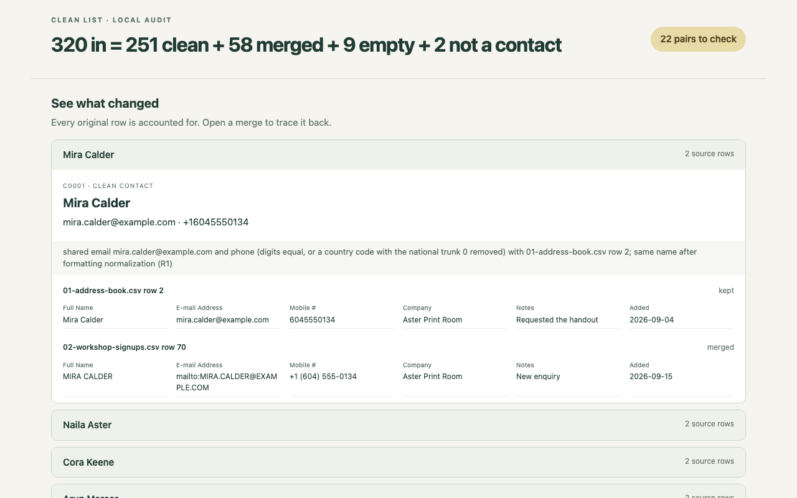

# Clean List



One clean contact list, with a row-by-row account of what happened. The screenshot
comes from the bundled fictional example's actual HTML report:

**320 in = 251 clean + 58 merged + 9 empty + 2 not a contact** · **22 pairs to check**.
The image was captured at 1280 × 800. On narrow screens, original-row evidence
stacks each value under its label; all fields remain readable without sideways scrolling.

## Quick start

Requires Python 3.9 or newer. No packages, account, network access, or installation
are needed. Start in this skill folder in a fresh copy:

```sh
python3 scripts/clean_list.py --selftest
python3 scripts/clean_list.py --demo --out demo-output
```

Open `demo-output/report.html` in your browser, or `demo-output/clean.xlsx` in a
spreadsheet app. Each run creates those two files plus `demo-output/audit.json`.
Use a new output folder each time; the tool refuses to overwrite an earlier run.

For your files:

```sh
python3 scripts/clean_list.py contacts.csv event-signups.xlsx --out cleaned-contacts
```

**In Claude Code or Codex:** open a session in this skill folder and say:

> Read SKILL.md and use this skill to run the bundled demo into demo-output.
> Tell me how the counts add up and where I can review the uncertain pairs.

For an actual task, substitute your local filenames and a new destination. This
explicit file-based quick start works without changing either agent's configuration.
The skill's path note explains how agents resolve its script location. Automatic
skill discovery depends on your agent's configured skill directories; this package
does not change them.

The skill is named `nk-clean-list`. To use it from any project, clone it into
the folder where your agent looks for skills, then start a new session:

```sh
# Claude Code
git clone https://github.com/NickkkLian/nk-clean-list ~/.claude/skills/nk-clean-list
# OpenAI Codex
git clone https://github.com/NickkkLian/nk-clean-list ~/.agents/skills/nk-clean-list
```

## What you receive

- **clean.xlsx:** clean contacts, merge evidence, uncertain pairs, every original
  cell with its file/sheet/row/column, normalization changes, review items, headers,
  and XLSX cell metadata. Input formulas remain text.
- **report.html:** one self-contained page. The count and first opened merge are
  visible at a desktop viewport without scrolling. Open any other merge or pair
  to see its clean contacts and original rows. No fonts, scripts, images or data
  are fetched from another site.
- **audit.json:** the same counts, dispositions, source references and decisions,
  plus the original source bytes and SHA-256 hashes. It contains your full input
  data, including columns that are not contact fields.

Every data row is **kept**, **merged**, **empty**, or **not_contact**. Headers and
title rows are reported separately. Blank rows between data count; trailing blank
rows do not. A row containing only a date, ID or note is empty for contact purposes,
but its values are still retained.

The first nonempty source name is the display name. Other name spellings remain
as variants. All distinct emails survive a merge. Equivalent phone formats become
one number, the longest digit form. If a source row wrote that form with a country
code (`+1 (604) 555-0134`, or `00` in place of the plus), the clean number keeps the
plus: `+16045550134`. A number that no row wrote with a country code stays digits
only (`6045550134`); the tool never adds a country code. In `clean.xlsx` every value
is a text cell, so the plus stays as written. The assembly decision and every
observed form are recorded.

## Conservative matching

A merge needs the same name **and** a shared email or phone. Case, accents,
punctuation, spacing, title and name order are formatting. Initials, suffixes,
missing name parts and possible nicknames are uncertain. Name alone never merges.
Organisations without a person name can merge with other organisation rows, never
with people. A row that bridges conflicting names joins neither side.

Chinese characters match exactly after spacing/width normalization. Supported
Chinese names also match family-first pinyin with joined or spaced syllables,
including `周子墨` / `Zhou Zimo`, `何雨童` / `He Yu Tong` / `HE, Yutong`.
Case, tones, punctuation and spaces are ignored. The brief's given-first spelling
also works; the given-name syllables keep their order. The vowel ü accepts `ü`,
`v` or `u:`. [pinyin.json](references/pinyin.json) is a **limited hand-authored
Mandarin table**, with no external data or fallback. Its arrays enumerate readings,
including alternatives such as 单 → dan/shan/chan and 乐 → le/yue/yao/lao. Matching
checks every listed reading without choosing a pronunciation for the person.

A matching name plus a shared email or phone merges with both kinds of evidence
in the reason. A matching name alone is uncertain. If pinyin fits two different
Chinese names, a link to just one merges with that one and leaves an uncertain
pair with the other. An identifier shared with both leaves all three separate and
lists both pairs. Different Chinese spellings never become equal through pinyin.
Characters outside the table produce a review item and linked uncertain pairs.
See [matching rules](references/matching.md).

### Character coverage

The table covers **714 characters**, including simplified and traditional forms
as separate entries; **76** have multiple readings after tones are removed.
The exact covered characters follow. Each character's supported readings and the
compound surname list are documented in [pinyin.json](references/pinyin.json).
This finite coverage does not include every Chinese name or dialect.

```text
一丁万上丘东丞严丰临丹丽义乐乔书乾予于云亮付仙任伊伟伶何余佟佳依侯俊俞俟倩倪偉傅傑元兆先克公兰军冬冯凌凡凤凯凱函刘刚利剛
劉力勇勝勤包区區千升华卓单博卜卢卿原叔可史叶司吉同名向吕君吳吴呂周哲唐唯善喬單嘉嚴国圆國圓圣均坤城堃墨夏夕夢天奇奕妍妘妤
妮姚姜威娅娜娟娴婉婧婭婴婷媛嫻嬰子孔孙孟季孫宁宇安宋宏官宣家宸容宾寒寧寰尉小尚尤尹岑岚岩岳峰峻崔嵐左巧帅帆希帥平庄廉廖建
弈弘张張強强彤彬彭徐徒德心忆志忱忻思怡恆恒恩悅悦意慕慧憶懿成戚戴扬承抒振揚政敏敬文斌新方昂昊明易昕春昭昱显晉晋晏晓晗晞晟
晨景晴晶智曈曉曦書曹曼曾月朔朗朝木末朱杉李杜杨杰東松林枫柏查柯柳桂桐桓桥桦梁梅梓梦梨梵森楊楓榮槿樂樱樺橋櫻欢欣欧歆歐歡正
武段毅毛汐江池汤汪沈沉沐沫泓泱泽洁洋洛洪浅浩海涛涵淑淺清温湯源溪溫满滨滿漫潇潔潘澄澜澤濤濱瀚瀟瀾灏灝灵炜烁然煒煜熊熙燕爍
牛玄玉王玥玮玲玺珂珊珍珺琅琛琦琪琳琴瑋瑛瑞瑤瑩瑶瑾璇璐璟璽甄生甫田白皇皓盈益盟盧真睦睿石研硕碩磊祝祯祺禎禹秀秋科秦程稳穆
穎穩空立章竣童笙筠範紅維綺緣繁纓纖红纤绮维缘缨罗羅羊美義羽翁翟翡翰翼聖聞肖胜胡胤臣臨臻舒航良艳艷艺艾芊芬芳芸芹苏苗若英茁
范茉茗茜茵荣荷莉莊莫莲莹菁菡華菱菲萌萍萤萧萬萱落葉葛董蒋蒙蓉蓓蓝蓮蔓蔚蔡蔣蕊蕭蕴蕾薄薇薛藍藝蘇蘊蘭虹螢行衡袁裕西覃解言許
詩誠誼諸諾謙謝譚许诗诚诸诺谊谢谦谭豐豪貝賀賈賓賢賴贝贤贺贾赖赵超越趙路車軍軒车轩辛辰迁进远迟進逸遠遲遷邓邢邬邱邵邹郑郝郭
鄒鄔鄧鄭重量金鈕鈞銀銘銳鋒錢錦鍾鑫钟钧钮钱铭银锋锐锦長长閆閻闫闻阎阮阳陆陈陳陶陸陽雁雅雨雪雯雲雷震霏霖霞露靈青靖静靜韋韓
韦韩音韵韻頌顏顥顧顯顾颂颖颜颢飛飞馨馬馮駿騏驍马骁骏骐高魏魯鲁鳳鳴鴻鵬鸣鸿鹏鹿麒麓麗黃黄黎默齊齐齡龄龍龔龙龚
```

## Input details

CSV accepts comma, semicolon or tab separators, LF/CRLF, UTF-8 (with or without BOM),
UTF-16, GB18030/GBK and Windows-1252. BOM and valid UTF-8 are recognized first. Some
legacy byte sequences decode under several codecs. Identical GBK/GB18030 readings
are combined; coherent Chinese text or readable accented Latin words distinguish
ordinary exports from the competing garbled reading. When the readings remain
undecidable, the refusal shows a short sample of each candidate and asks you to
name the encoding, for example:

```sh
python3 scripts/clean_list.py older-export.csv --encoding cp1252 --out older-cleaned
```

XLSX accepts shared strings, inline strings, numbers, date cells, merged cells and
multiple worksheets. Source formulas are preserved as text and are not evaluated.
Date serials remain stored values; their style metadata and original workbook bytes
are retained. The report does not emulate Excel's date/number display formatting.
Merged data cells are not filled down, because that would invent row values.

Column roles use both labels and sampled values: email addresses, phone forms,
person names and adjacent first/last name parts. Title and group rows above the
actual field row are reported as headers, including groups formed with merged
cells. The audit and workbook's Column roles sheet record the inference evidence.
When no name column can be identified, the terminal's first summary line and the
top of the report warn that person matching is unavailable. The counted equation
still accounts for every row; it is shown after that warning. Ambiguous name columns
are left unassigned rather than selected arbitrarily. If
header detection fails, inspect the export and provide the last header row:

```sh
python3 scripts/clean_list.py titled-export.csv --header-row 4 --out titled-cleaned
```

## Restore originals

```sh
python3 scripts/clean_list.py --restore cleaned-contacts/audit.json --out restored-originals
```

This writes copies with the original bytes and verifies their hashes. It does not
replace any input. To undo a single merge, use its source references to retrieve the
original cells from the workbook or JSON. Full-file restoration also preserves
quoting, line endings, XLSX styles and formulas.

## Alongside your existing tools

Excel's Remove Duplicates is convenient for exact duplicates and familiar spreadsheet
work. OpenRefine offers richer clustering choices and a reusable transformation
history. A CRM's merge works with live records, activity history and the team's
existing workflow. Those are useful advantages. Clean List's narrower job is an
offline, export-level account: what was kept, what merged and why, and what still
needs a person to decide. It does not claim better identity matching than those tools.

For developers, [dedupe](https://docs.dedupe.io/en/latest/) uses machine learning
with human-labelled data to find similar records, including in very large databases.
Its documentation lists “custom data types, string comparators and blocking rules”.
That makes it a better fit for developers who need trained or tailored matching.
Clean List uses fixed name-and-identifier rules, needs no training, and packages
each run as a clean workbook, an offline HTML report, and a row-by-row JSON audit
with uncertain pairs and byte-exact source restoration. It does not claim better
matching than dedupe.

## What it does not do

- Verify email delivery, telephone ownership, identity, or current contact details.
- Enrich contacts, contact anyone, call an API, or upload data.
- Guess unsupported pinyin readings, nicknames, encoding, or spreadsheet formulas.
- Accept old binary `.xls`, PDFs, scanned lists, password-protected workbooks, or
  arbitrary spreadsheet layouts. Save `.xls` as `.xlsx` or UTF-8 CSV first.
- Handle more than 6,000 contact rows per run or an XLSX archive expanding beyond
  256 MiB. Matching is pairwise; this is intended for modest exported lists.
- Fit values over Excel's 32,767-character cell limit into a workbook. Such a run
  is refused before creating its output folder.
- Edit sources, overwrite previous outputs, or publish anything.

All bundled people and organisations are invented. Email domains are reserved for
examples; phone numbers use fictional ranges. MIT licensed; see
[license](references/LICENSE.txt). Audit schema: [references/audit.md](references/audit.md).
